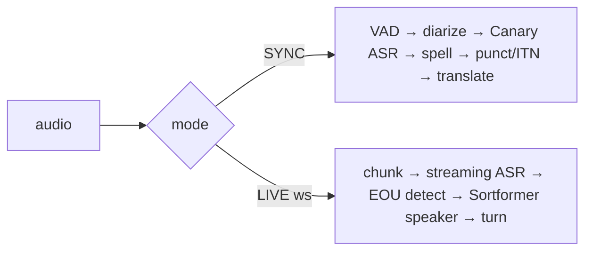

# Luganda STT + Translation (batch + live)

End-to-end Luganda speech pipeline built on **NVIDIA NeMo**, with two serving modes:

| Mode | Model | Latency | Use case |
|------|-------|---------|----------|
| **SYNC** (batch) | Canary-1B-Flash (AED) + NGPU-LM + GPU-PB boosting → spell → punct/ITN → translation | high (offline) | file upload, highest accuracy |
| **LIVE** (streaming) | cache-aware streaming FastConformer/Parakeet + **end-of-turn detection** + Sortformer streaming diarizer | ~100–500 ms | real-time conversation |

Luganda has no dedicated Canary language token, so it is mapped onto the **English
prompt slot** (`source_lang=target_lang="en"`) — Canary's BPE already covers
Latin-script Luganda text and the model learns the rest during fine-tuning.



---

## 1. Environment

Use the NeMo container (bundles a matching NeMo + CUDA):

```bash
docker run --gpus all -it --shm-size=16g \
  -v $PWD:/app -w /app \
  nvcr.io/nvidia/nemo:25.07 bash

pip install -e .
export HF_TOKEN=hf_xxx          # gated datasets/models (Common Voice, Sortformer)
huggingface-cli login
```

> The committed `data/manifests/*.json` contain absolute paths from the authoring
> machine. **Re-run data prep on your box** (Step 2) so paths + audio regenerate.

---

## 2. Data preparation

```bash
python scripts/prepare_data.py --source fleurs --max-samples 5000
#   alternatives:  --source commonvoice     |     --cv-dir /path/to/extracted/cv/lg
python scripts/build_spell_dict.py
python -m pytest tests/test_manifests.py -q          # validate Canary schema
```

Manifest schema (one JSON/line):
```json
{"audio_filepath": "...wav", "duration": 3.2, "text": "...",
 "taskname": "asr", "pnc": "no", "source_lang": "en", "target_lang": "en"}
```

---

## 3. Train the SYNC model (Canary)

```bash
# smoke first (catch API drift in minutes)
python scripts/finetune_canary.py trainer.max_steps=20 trainer.max_epochs=1 model.train_ds.batch_size=2

# full run
python scripts/finetune_canary.py                    # configs/finetune_canary.yaml
# multi-GPU:  python scripts/finetune_canary.py trainer.devices=4
```
Output: `outputs/canary_luganda/canary_luganda.nemo`

One-command orchestration (prepare → LM → finetune → evaluate WER/CER → register):
```bash
python scripts/training_flow.py run --max-samples 5000 --freeze-encoder True
```

---

## 4. Train the LIVE model (cache-aware streaming FastConformer)

```bash
python scripts/build_tokenizer.py --vocab-size 1024          # -> data/tokenizers/luganda_spe

# smoke
python scripts/train_streaming_asr.py \
  model.tokenizer.dir=data/tokenizers/luganda_spe \
  trainer.max_steps=20 trainer.max_epochs=1 model.train_ds.batch_size=2

# full run
python scripts/train_streaming_asr.py model.tokenizer.dir=data/tokenizers/luganda_spe
```
Output: `outputs/streaming_luganda/streaming_luganda.nemo`

The encoder is initialised from a pretrained cache-aware streaming model; the
Luganda decoder/joint are trained fresh (see `configs/finetune_streaming_conformer.yaml`).
Latency knob: `model.encoder.att_context_size=[70,13]` → look-ahead
`13 × 8 × 0.01 = 1.04 s`; lower the right context for lower latency.

---

## 5. Benchmark — WER **and** CER, SYNC vs LIVE, baseline vs fine-tuned

`scripts/benchmark.py` scores everything against the **ground-truth transcripts**
in the test manifest (held-out FLEURS/Common Voice Luganda). It compares three
kinds of reference:

1. **Own base checkpoint** (same architecture, no Luganda training) — measures the
   *lift from fine-tuning*. Defaults: `nvidia/canary-1b-flash` (SYNC),
   `nvidia/parakeet_realtime_eou_120m-v1` (LIVE).
2. **Self, offline** (LIVE only) — the fine-tuned streaming model decoded in full
   context, to expose the **streaming penalty** (streaming − offline).
3. **External Luganda-capable models** (`--external`) — *competitive* references:
   Meta **MMS** (`facebook/mms-1b-all`, native `lug` adapter) and **Whisper
   large-v3** (`lg`). Requires `transformers`.

> Note: the own-base baselines are English/multilingual with no Luganda training,
> so their WER/CER will be very high — that comparison answers "did fine-tuning
> help?", while `--external` answers "are we competitive with the field?".

```bash
python scripts/benchmark.py --mode both \
  --test-manifest data/manifests/test.json \
  --canary-finetuned    outputs/canary_luganda/canary_luganda.nemo \
  --streaming-finetuned outputs/streaming_luganda/streaming_luganda.nemo \
  --max-samples 200
```

Add competitive Luganda baselines (needs `pip install transformers`):
```bash
python scripts/benchmark.py --mode sync \
  --canary-finetuned outputs/canary_luganda/canary_luganda.nemo \
  --external mms,whisper
```

Run a single mode with `--mode sync` or `--mode live`. Baselines default to
`nvidia/canary-1b-flash` and `nvidia/parakeet_realtime_eou_120m-v1` (override with
`--canary-baseline` / `--streaming-baseline`).

Example output:
```
=== SYNC ===
model                           WER%    CER%
--------------------------------------------
baseline                       62.10   28.40
finetuned                      31.05   12.20
improvement                    31.05   16.20
(lower is better; improvement = baseline - finetuned, positive is better)

=== LIVE ===
model                           WER%    CER%
--------------------------------------------
baseline                       70.30   33.10
finetuned                      36.40   15.80
finetuned_offline              33.90   14.10
improvement                    33.90   17.30
streaming_penalty               2.50    1.70

=== EXTERNAL ===        # only with --external (competitive Luganda models)
model                           WER%    CER%
--------------------------------------------
mms                            28.70   10.10
whisper                        41.30   17.80
```

**Reading it:** `improvement` > 0 means the fine-tune beats the baseline.
`streaming_penalty` is how much accuracy you trade for real-time (streaming − offline
on the same model). Results are also written to `outputs/benchmarks/bench_<ts>.json`.

Cross-check streaming vs offline parity with NeMo's own harness:
```bash
python <nemo>/examples/asr/asr_cache_aware_streaming/speech_to_text_cache_aware_streaming_infer.py \
  model_path=outputs/streaming_luganda/streaming_luganda.nemo \
  dataset_manifest=data/manifests/test.json compare_vs_offline=true
```

---

## 6. Serve

```bash
# .env
FINETUNED_CHECKPOINT=outputs/canary_luganda/canary_luganda.nemo
STREAMING_ASR_CHECKPOINT=outputs/streaming_luganda/streaming_luganda.nemo
USE_EOU_TOKENS=false      # a Luganda FT won't emit <EOU>; use VAD endpointing

uvicorn src.server:app --host 0.0.0.0 --port 8024
```

- **SYNC:** `POST /transcribe` (multipart WAV/FLAC/MP3), `?mode=fast|rich`.
- **LIVE:** `WS /ws/transcribe` — stream 16 kHz mono **int16 PCM** binary frames;
  receive JSON events:
  ```json
  {"type":"interim","text":"omwana ali"}
  {"type":"turn","text":"OMWANA ALI WANO","speaker":"speaker_1",
   "reason":"silence","backchannel":false}
  ```
  Send text `"eos"` (or disconnect) to flush the final turn.
- `GET /health` reports model/boosting/diarization/streaming status.

### End-of-turn detection
`src/turn_detection.py` combines two signals (NeMo Voice Agent design):
1. Inline `<EOU>`/`<EOB>` tokens from EOU-capable models (`parakeet_realtime_eou_120m-v1`).
2. VAD trailing-silence endpointing (`TURN_STOP_SECS`) for models without turn tokens.
Plus a `TURN_MAX_BUFFER_WORDS` hard flush. Tune via env (see `.env.example`).

---

## 7. Tests

```bash
# offline (no GPU/NeMo needed) — metrics (WER/CER), manifest schema, turn detection
python -m pytest tests/test_metrics.py tests/test_manifests.py tests/test_turn_detection.py -q

# integration (needs a running server on :8024)
python -m pytest tests/test_acceptance.py tests/test_ab.py tests/test_regression.py -q
```

---

## 8. Config reference (`.env` / `src/config.py`)

| Var | Default | Meaning |
|-----|---------|---------|
| `CANARY_MODEL` | `nvidia/canary-1b-flash` | batch ASR base |
| `FINETUNED_CHECKPOINT` | – | Luganda Canary `.nemo` |
| `STREAMING_ASR_MODEL` | `nvidia/parakeet_realtime_eou_120m-v1` | live ASR base |
| `STREAMING_ASR_CHECKPOINT` | – | Luganda streaming `.nemo` |
| `DECODER_TYPE` | `rnnt` | `rnnt`/`ctc` (hybrid models) |
| `TURN_STOP_SECS` | `0.8` | trailing silence that ends a turn |
| `TURN_MAX_BUFFER_WORDS` | `60` | hard turn flush |
| `USE_EOU_TOKENS` | `true` | honour inline `<EOU>`/`<EOB>` |
| `DIAR_STREAMING_MODEL` | `nvidia/diar_streaming_sortformer_4spk-v2` | streaming diarizer |

---

## Caveats / first-run watchpoints

- Canary base translates en/de/fr/es only, so Luganda→English `translate()` is
  effectively pass-through; SALM (`mode=rich`) is the real translation path.
- First GPU run may need a tweak in: Canary lang-token handling, the streaming
  encoder `init_from_pretrained_model.include/exclude`, or the Sortformer output
  parser (`src/streaming_diarizer.py:_parse_sortformer_output`).
- The live session re-decodes the growing turn buffer per chunk (cache-aware
  streaming output == offline, so correct); persistent-cache incremental decoding
  is the next optimization.
